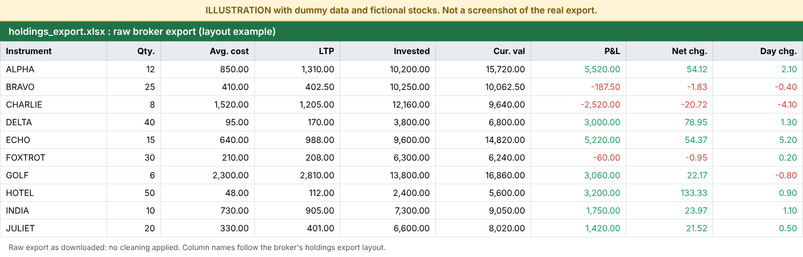
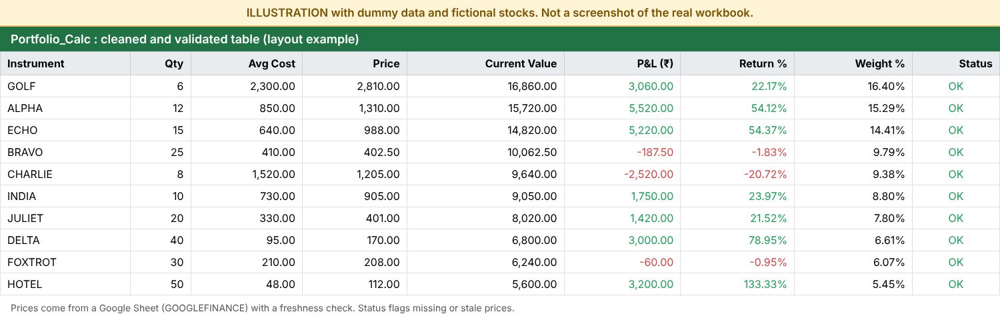
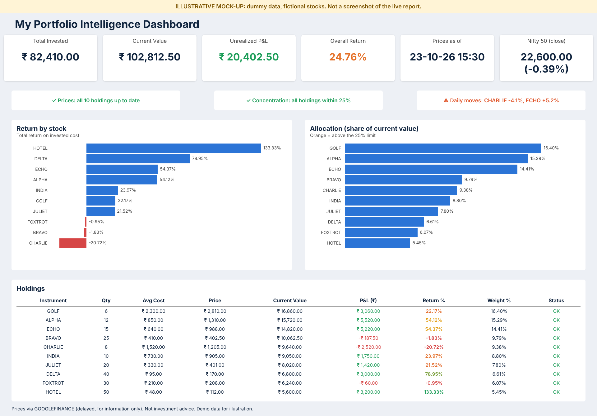
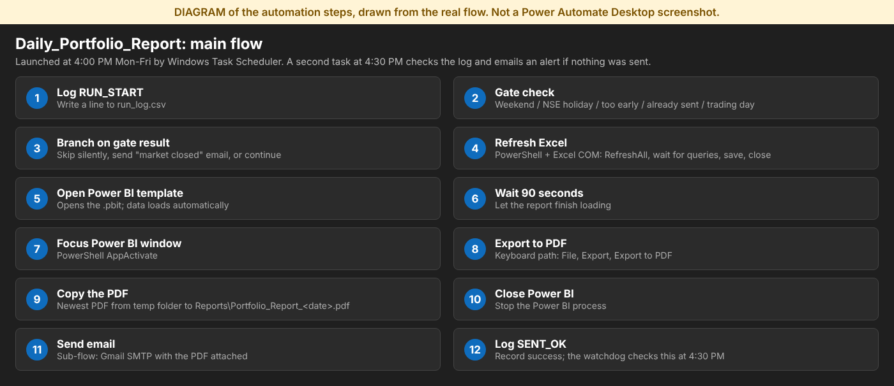

# Personal Portfolio Intelligence & Risk Monitor

A free-tools, end-to-end pipeline that turns a broker holdings export into a one-page daily risk dashboard, exports it to PDF and emails it every trading day at 4:00 PM IST.

Built on Windows 11 with Excel/Power Query, Power BI Desktop, Power Automate Desktop (free) and Windows Task Scheduler. No SQL, no Python, no paid services.

## Built with AI assistance

I built this project as a beginner, with step-by-step help from Claude (Anthropic's AI assistant) for the PowerShell scripts, the Power Automate flow design, Power Query / DAX guidance, troubleshooting and documentation. I tested every step myself on my own machine, made the design decisions, and the holdings data is my own. Claude never had access to my accounts or passwords.

## What it does

1. Reads a Kite holdings export (Excel).
2. Cleans and validates it with Power Query.
3. Pulls end-of-day prices through a Google Sheet (`GOOGLEFINANCE`) published as CSV, with a timestamp and a freshness check.
4. Calculates value, P&L, allocation, concentration vs a 25% limit and daily moves. A second small Google Sheet tab (`Index`) supplies the Nifty 50 closing level and % change.
5. Shows one dark Power BI page, "My Portfolio Intelligence Dashboard": six KPI cards (invested, value, unrealized P&L, overall return coloured on a red-orange-green scale, price timestamp, Nifty 50 close), three alert strips whose text and colour change with the data (stale prices, concentration above 25%, big daily moves), a concentration gauge, a donut of where the money is, a return-by-stock chart, invested-vs-current-value columns and today's move by stock.
6. Exports the page to PDF and emails it via Gmail SMTP.
7. Runs on schedule (Mon-Fri 4:00 PM) with a trading-day gate, a run log and a 4:30 PM watchdog that emails an alert if nothing was sent.

## Walkthrough (illustrations)

All images below are **illustrations made with dummy data and fictional stocks**, labelled as such on the image. None of them is a screenshot of my real holdings or my real Excel / Power Automate windows.

**1. Raw broker export** (layout example)



**2. Cleaned and validated Excel table** (layout example)



**3. Power BI dashboard** (illustrative mock-up of the real one-page layout, dark theme)



**4. Automation flow** (diagram of the real steps, not a Power Automate screenshot)



**Privacy disclaimer:** Screenshots and sample datasets may contain dummy or anonymized data for demonstration purposes. Actual personal portfolio holdings and sensitive information have been omitted for privacy. Demonstration results may differ from actual results.

## Architecture

```
Kite holdings .xlsx
      |
Excel (Power Query: clean, validate, join prices) -- Portfolio_Model.xlsx
      |  refreshed by PowerShell/COM before each run
Power BI template (.pbit) -> dashboard -> Export to PDF
      |
Reports\Portfolio_Report_<date>.pdf -> Gmail SMTP (PowerShell)
      ^
Task Scheduler 4:00 PM -> Run_Daily_Report.ps1 -> Power Automate Desktop flow
Task Scheduler 4:30 PM -> Check_Daily_Report.ps1 (watchdog)
```

Daily flow inside Power Automate Desktop: log start -> gate (weekend / NSE holiday / too early / already sent / trading) -> refresh Excel -> open Power BI template -> keyboard export to PDF -> copy PDF from `%TEMP%` -> close Power BI -> email -> log `SENT_OK`.

## Repository layout

| Path | Purpose |
|---|---|
| `Scripts/` | PowerShell used by Task Scheduler and the PAD flow (placeholders for private values) |
| `Data/NSE_Holidays_2026.csv` | NSE trading holidays used by the gate |
| `Screenshots/` | Dashboard and automation screenshots (demo/blurred data only) |
| `Docs/AUTOMATION.md` | Setup steps for scheduling, credentials and the PAD flow |
| `Docs/TROUBLESHOOTING.md` | Problems met and their fixes |
| `logs/`, `Reports/` | Created at runtime, git-ignored |

The Excel model, Power BI files and flow definitions are not included because they contain real holdings.

## Security

- No passwords in the repo. The Gmail app password lives in the Windows user environment variable `GMAIL_APP_PASSWORD`, set once by the owner.
- Never open or screenshot PAD's Variables pane while a variable holds a secret.
- `.gitignore` excludes PDFs, `.pbix/.pbit`, `.xlsx`, logs and screenshots. The published Google Sheet link and PAD Run URL are placeholders (`<RUN_URL>`) and must stay private.

## Limitations (honest list)

- Prices come from Google's `GOOGLEFINANCE`: delayed, not a licensed feed. Check Google's terms; for personal use only.
- Average cost is rounded in the broker export, so P&L is approximate.
- A holdings row with a blank symbol is silently dropped.
- Power BI Desktop has no command-line export, so the PDF step uses keyboard automation (Alt, F, Enter, Down x7...). It can break if Power BI's menus change.
- Editing the dashboard means re-exporting the `.pbit` template, otherwise the flow keeps using the old design.
- `Send-MailMessage` is obsolete but works with Gmail SMTP; the PAD built-in email action did not.
- Requires the PC/VM to be on, awake, signed in and unlocked at 4 PM (here: a UTM VM on a MacBook Air, plugged in, lid open). The watchdog cannot detect a machine that is off.
- The duplicate-send guard relies on `run_log.csv`; deleting the log after the report was sent causes a second run.
- Holidays are a static 2026 list; Muhurat (special weekend) sessions are not handled.
- PAD free tier cannot schedule flows, hence Task Scheduler.

## What this project demonstrates

- Cleaning and validating a broker export with Power Query, and calculating portfolio metrics (P&L, return, allocation, concentration).
- A one-page Power BI dashboard with conditional formatting and alert logic.
- End-to-end automation with free tools: Excel refresh, PDF export, email, scheduling, a run log and a failure watchdog.
- Practical engineering habits: duplicate-send guards, holiday handling, secrets kept out of code, and honest documentation of limitations.

## What I learned

- Keyboard-driven UI automation is fragile; opening a saved template was far more reliable than automating a Refresh button.
- Logs and small checks (gate, duplicate guard, watchdog) matter more than the "happy path".
- Keep secrets in environment variables, and test each step by hand before scheduling it.

## How to view or run

The repository holds the scripts and documentation only. The Excel model, Power BI files and flow definitions are not included because they contain real holdings, so the pipeline cannot be run from this repo as it stands. To rebuild it, follow `Docs/AUTOMATION.md` with your own holdings export, price sheet and Gmail app password.

## Setup

See `Docs/AUTOMATION.md`.
